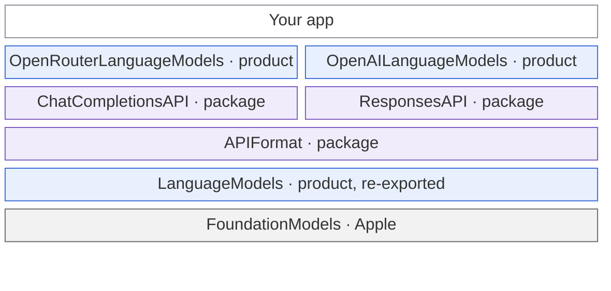
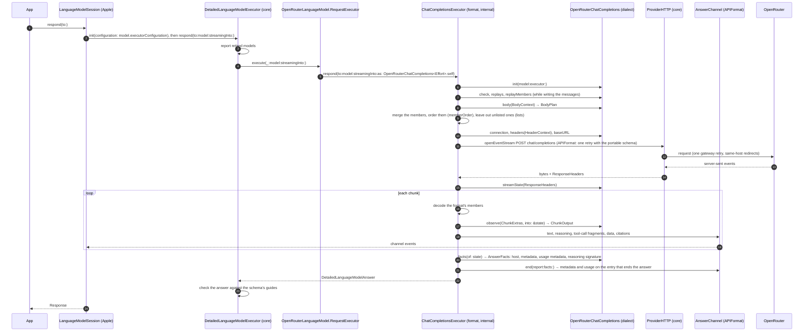
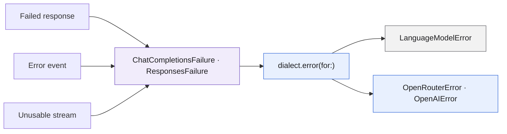
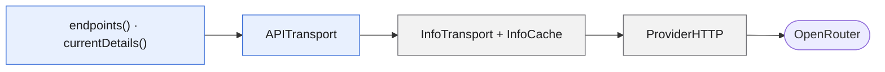
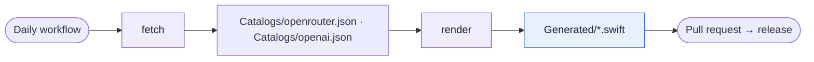

# Architecture

A map of the code for contributors: which module depends on which, how one request travels from an app to a provider
and back, and which provider hook runs at which step. [CONTRIBUTING](CONTRIBUTING.md) has the rules: where shared code
goes and how a module's files are laid out.

## Modules



Each layer builds on the ones below it. Blue: products apps can import. Purple: package targets apps never see. Gray:
Apple.

- An app imports only the provider modules it uses, such as `OpenRouterLanguageModels` or `OpenAILanguageModels`. Each
  one re-exports the core, so efforts, `DetailedLanguageModel` and logging come with it.
- `ChatCompletionsAPI`, `ResponsesAPI` and `APIFormat` are `package` targets: apps can't see them, provider modules can.
  A provider module names its format only in its format folder, such as `ChatCompletions/` or `Responses/`, and never
  imports `APIFormat`.
- OpenRouter speaks OpenAI's Chat Completions format, and OpenAI its Responses format. Each format target builds on
  `APIFormat` and the core; `APIFormat` builds on the core alone. The generator and its plugin are build tools: they
  write each module's `Generated/` sources and never ship.

## One request

A Chat Completions request, from OpenRouter's model:



Where each step lives:

| Step | File |
|---|---|
| Foundation Models' executor, the checks before and after | `Sources/LanguageModels/DetailedLanguageModelExecutor.swift` |
| OpenRouter's one call into the format | `Sources/OpenRouterLanguageModels/ChatCompletions/RequestExecutor+ChatCompletions.swift` |
| The format's only entry, which creates the dialect | `Sources/ChatCompletionsAPI/DetailedLanguageModelRequestExecutor+ChatCompletions.swift` |
| The engine: build, send, stream | `Sources/ChatCompletionsAPI/Internal/ChatCompletionsExecutor.swift` |
| The body and its messages | `Sources/ChatCompletionsAPI/Internal/Request/` |
| Chunks into the answer's output | `Sources/ChatCompletionsAPI/Internal/Stream/AnswerStream.swift` |
| The answer's channel events, facts and usage | `Sources/APIFormat/AnswerChannel.swift` |
| Opening the stream with the portable-schema retry, the stream loop and the log | `Sources/APIFormat/ProviderConnection+EventStream.swift`, `OperationLog+Request.swift` |
| OpenRouter's hooks | `Sources/OpenRouterLanguageModels/ChatCompletions/` |

## A Responses request

OpenAI's model takes the same path through the core and `APIFormat`, with the Responses format in the middle:

```mermaid
sequenceDiagram
    autonumber
    participant RE as OpenAILanguageModel.RequestExecutor
    participant Engine as ResponsesExecutor (format, internal)
    participant D as OpenAIResponses (dialect)
    participant HTTP as ProviderHTTP (core)
    participant Channel as AnswerChannel (APIFormat)
    participant OA as OpenAI

    RE->>Engine: respond(to:model:streamingInto:as: OpenAIResponses<Effort>.self)
    Engine->>D: check, instructionsRole, replays, replayMembers (while writing the input items)
    Engine->>D: body(BodyContext) → BodyPlan: storage, encrypted reasoning, reasoning, text members
    Engine->>Engine: merge, order, leave out unlisted and unsent members, keep only encrypted reasoning when not stored
    Engine->>HTTP: openEventStream POST responses (one gateway retry, then one portable-schema retry)
    HTTP->>OA: request
    OA-->>Engine: events + ResponseHeaders
    loop each event
        Engine->>D: observe(EventExtras, into: &state) → EventOutput
        Engine->>Channel: text, reasoning summaries, function calls by output index, citations, data
    end
    Note over Engine: response.completed or response.incomplete ends the answer; error or response.failed throws
    Engine->>D: facts(of: state) → AnswerFacts
    Engine->>Channel: end: reasoning items as the signature, message phases, metadata, usage
```

| Step | File |
|---|---|
| OpenAI's one call into the format | `Sources/OpenAILanguageModels/Responses/RequestExecutor+Responses.swift` |
| The format's only entry, which creates the dialect | `Sources/ResponsesAPI/DetailedLanguageModelRequestExecutor+Responses.swift` |
| The engine: build, send, stream | `Sources/ResponsesAPI/Internal/ResponsesExecutor.swift` |
| The body and its input items | `Sources/ResponsesAPI/Internal/Request/` |
| Events into the answer's output | `Sources/ResponsesAPI/Internal/Stream/AnswerStream.swift` |
| OpenAI's hooks | `Sources/OpenAILanguageModels/Responses/` |

## Dialect hooks

The engine owns the exchange; a dialect adds only what its provider does differently. Each hook receives a value only
the engine creates, holding just what that hook needs. Both formats' dialects share the hooks of `ProviderDialect` and
the same hook names; the Responses format adds two.

| Hook | Required | Receives | Returns | OpenRouter (Chat Completions) | OpenAI (Responses) |
|---|---|---|---|---|---|
| `name`, `modelID`, `baseURL`, `connection`, `init(model:executor:)` | yes | the model and its request executor | who, where, how | `"OpenRouter"`, the variant's model id, a proxy's URL, session, auth and timeouts | `"OpenAI"`, the model's id, a proxy's URL, session, auth and timeouts |
| `error(for:)` | yes | `ChatCompletionsFailure<Self>` or `ResponsesFailure<Self>` | `MappedError<ProviderError>` | `LanguageModelError` or `OpenRouterError` | `LanguageModelError` or `OpenAIError` |
| `headers(_:)` | no | `HeaderContext` | `[HTTPHeaderName: String]` | the app's name, address and categories, the response cache, router metadata | none |
| `body(_:)` | when `BodyExtras` is set | `BodyContext` | `BodyPlan<BodyExtras>` | fallbacks, routing, plugins, reasoning, penalties, server tools, cache marks | the effort, summary and storage, the service tier, cache key and end user, the sampling a reasoning model doesn't take |
| `memberOrder`, `listedMembers`, `lists(_:)` | no | a `MemberKey` | an order, a predicate | the member order hosts cache on; leaving out what a model doesn't list | leaving out what a model doesn't list |
| `check(_:in:)`, `extraMedia` | no | `AttachmentKind`, the entry | throws, `[MediaPart]` | which inputs the models take; AIFF, M4A, AAC, FLAC and OGG audio, and video | which inputs the model takes |
| `instructionsRole` | no, Responses only | none | `InstructionsRole` | | `developer` for a model that reasons, `system` otherwise |
| `reasoningOrigin`, `phasesMetadataKey` | no | none | an origin, a metadata key | `openrouter` | `openai-responses`, `openAI.phases` |
| `replays(_:)`, `replayMembers(_:)` | when `ReplayMembers` is set, unless it's `ReasoningItem` | `[ReplayedReasoning]` | `ReplayMembers`, or Responses' items | `reasoning` and `reasoning_details`, back to the model that wrote them | the answer's encrypted `reasoning` items, back to the model that wrote them |
| `streamState(_:)`, `observe(_:into:)`, `facts(of:)` | when `ChunkExtras`, `EventExtras` or `StreamState` is set | `ResponseHeaders`, the extras | state, `ChunkOutput` or `EventOutput`, `AnswerFacts` | the host, cost, router report, cache status, images and reasoning details | the request's id |

A dialect that sets one of these types without the hook that reads it doesn't compile. Hooks with a default sit in the
extension that declares the conformance, where a misspelled one draws a warning.

## Errors



- A failed response reaches the dialect as an `HTTPRejection` with its error body decoded, and an error event as that
  body. A stream the format can't use arrives as a `StreamProblem`: an unreadable event, a cut-off stream or a broken
  tool call. A Chat Completions answer whose finish reason is `error` arrives as a failed answer, and a Responses
  `response.failed` event as a failed response, with its error object.
- Failures Foundation Models has a case for become `LanguageModelError`: a rate limit, an oversized context, a
  guardrail, a refusal, a timeout or an image the host can't use. The rest become the provider's own error, such as a
  rejected key, or credits or a quota that ran out. A `URLError` is rethrown as a failed connection's.

OpenRouter's info calls map their failures through the same `OpenRouterFailure`.

## Info calls



`OpenRouterLanguageModel` and `OpenRouterModel` read a model's endpoints and current details through a
`ProviderConnection`, like chat requests, with answers from the last minute reused. OpenAI's model has no info calls.

## The model catalog



`ModelCatalogGenerator fetch` downloads each source's documents into `Catalogs/`, and `render` turns them into typed
models, efforts, vocabularies and retired models. OpenRouter's come from its model list and API description. OpenAI's
come from three: the ids its API description names for the Responses API, the models its `/v1/models` still serves,
which needs an API key, and what models.dev says each model takes; a model past its shutdown day is left out.
`model-catalog.yml` runs both daily and opens a pull request whose release label `release.yml` reads.
