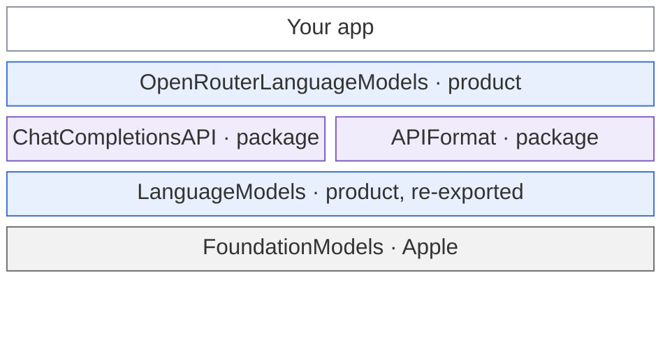
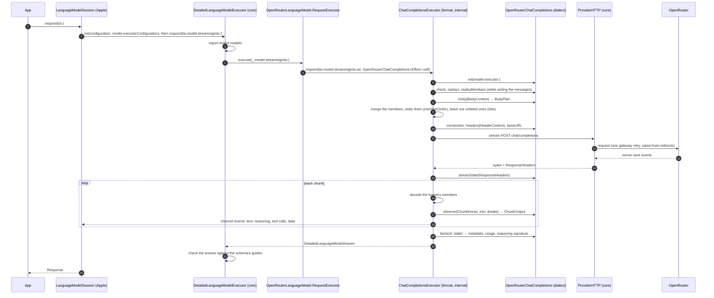
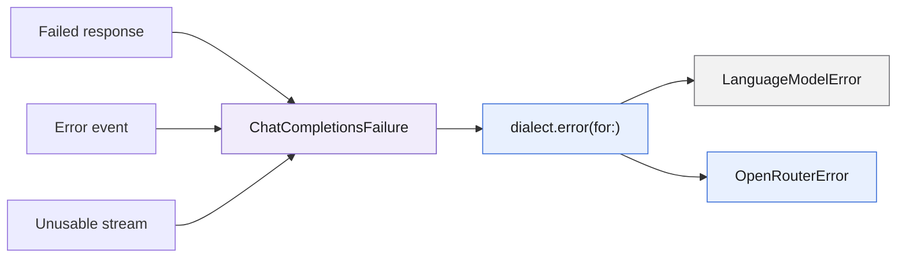
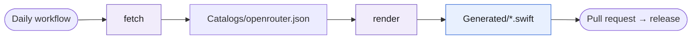

# Architecture

A map of the code for contributors: which module depends on which, how one request travels from an app to OpenRouter
and back, and which provider hook runs at which step. [CONTRIBUTING](CONTRIBUTING.md) has the rules: where shared code
goes and how a module's files are laid out.

## Modules

Each layer builds on the ones below it. Blue: products apps can import. Purple: package targets apps never see. Gray:
Apple.

- An app imports only `OpenRouterLanguageModels`. It re-exports the core, so efforts, `DetailedLanguageModel` and
  logging come with it.
- `ChatCompletionsAPI` and `APIFormat` are `package` targets: apps can't see them, provider modules can. A provider
  module names the format only in its format folder, `ChatCompletions/`, and never imports `APIFormat`.
- `ChatCompletionsAPI` builds on `APIFormat` and the core; `APIFormat` builds on the core alone. The generator and its
  plugin are build tools: they write each module's `Generated/` sources and never ship.
- A future format, such as the Responses API, is another target beside `ChatCompletionsAPI`, with a
  `ResponsesDialect: ProviderDialect` and the same hook names, reusing the core and `APIFormat`.

## One request

Where each step lives:

| Step | File |
|---|---|
| Foundation Models' executor, the checks before and after | `Sources/LanguageModels/DetailedLanguageModelExecutor.swift` |
| OpenRouter's one call into the format | `Sources/OpenRouterLanguageModels/ChatCompletions/RequestExecutor+ChatCompletions.swift` |
| The format's only entry, which creates the dialect | `Sources/ChatCompletionsAPI/DetailedLanguageModelRequestExecutor+ChatCompletions.swift` |
| The engine: send, retry, stream, log | `Sources/ChatCompletionsAPI/Internal/ChatCompletionsExecutor.swift` |
| The body and its messages | `Sources/ChatCompletionsAPI/Internal/Request/` |
| The answer's events | `Sources/ChatCompletionsAPI/Internal/Stream/AnswerStream.swift` |
| OpenRouter's hooks | `Sources/OpenRouterLanguageModels/ChatCompletions/` |

## Dialect hooks

The engine owns the exchange; a dialect adds only what its provider does differently. Each hook receives a value only
the engine creates, holding just what that hook needs.

| Hook | Required | Receives | Returns | OpenRouter uses it for |
|---|---|---|---|---|
| `name`, `modelID`, `baseURL`, `connection`, `init(model:executor:)` | yes | the model and its request executor | who, where, how | `"OpenRouter"`, the variant's model id, a proxy's URL, session, auth and timeouts |
| `error(for:)` | yes | `ChatCompletionsFailure<Self>` | `MappedError<ProviderError>` | `LanguageModelError` or `OpenRouterError` |
| `headers(_:)` | no | `HeaderContext` | `[HTTPHeaderName: String]` | the app's name, address and categories, the response cache, router metadata |
| `body(_:)` | when `BodyExtras` is set | `BodyContext` | `BodyPlan<BodyExtras>` | fallbacks, routing, plugins, reasoning, penalties, server tools, cache marks |
| `memberOrder`, `listedMembers`, `lists(_:)` | no | a `MemberKey` | an order, a predicate | the member order hosts cache on; leaving out what a model doesn't list |
| `check(_:in:)`, `extraMedia` | no | `AttachmentKind`, the entry | throws, `[MediaPart]` | which inputs the models take; AIFF, M4A, AAC, FLAC and OGG audio, and video |
| `replays(_:)`, `replayMembers(_:)` | when `ReplayMembers` is set | `[ReplayedReasoning]` | `ReplayMembers` | `reasoning` and `reasoning_details`, back to the model that wrote them |
| `streamState(_:)`, `observe(_:into:)`, `facts(of:)` | when `ChunkExtras` or `StreamState` is set | `ResponseHeaders`, `ChunkExtras` | state, `ChunkOutput`, `AnswerFacts` | the host, cost, router report, cache status, images and reasoning details |

A dialect that sets one of these types without the hook that reads it doesn't compile. Hooks with a default sit in the
extension that declares the conformance, where a misspelled one draws a warning.

## Errors

- A failed response reaches the dialect as an `HTTPRejection` with its error body decoded, and an error event as that
  body. A stream the format can't use arrives as a `Problem`: an unreadable chunk, a cut-off stream or a broken tool
  call. An answer whose finish reason is `error` arrives as a failed answer.
- Failures Foundation Models has a case for become `LanguageModelError`: a rate limit, an oversized context, a
  guardrail, a refusal, a timeout or an image the host can't use. The rest become `OpenRouterError`, such as a rejected
  key or no credits. A `URLError` is rethrown as a failed connection's.

The info calls map their failures through the same `OpenRouterFailure`.

## Info calls

`OpenRouterLanguageModel` and `OpenRouterModel` read a model's endpoints and current details through a
`ProviderConnection`, like chat requests, with answers from the last minute reused.

## The model catalog

`ModelCatalogGenerator fetch` downloads OpenRouter's model list and API description into `Catalogs/`, and `render`
turns them into typed models, efforts, vocabularies and retired models. `model-catalog.yml` runs both daily and opens a
pull request whose release label `release.yml` reads.
